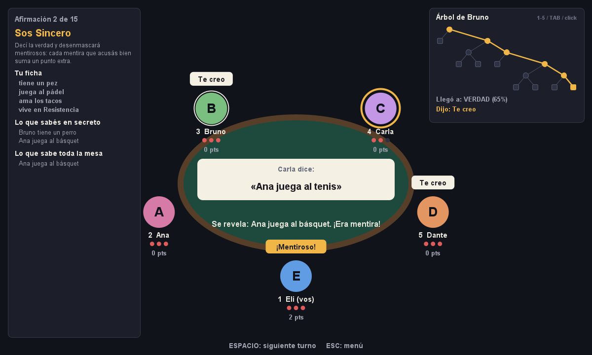
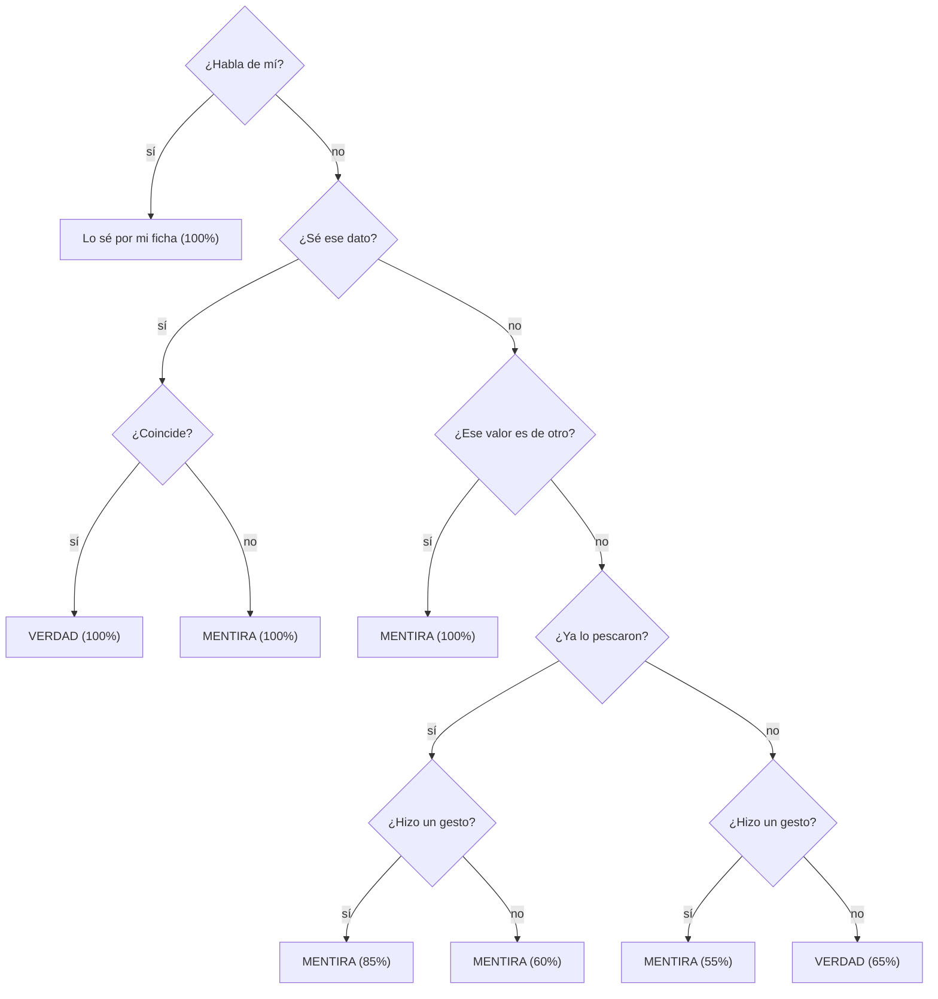
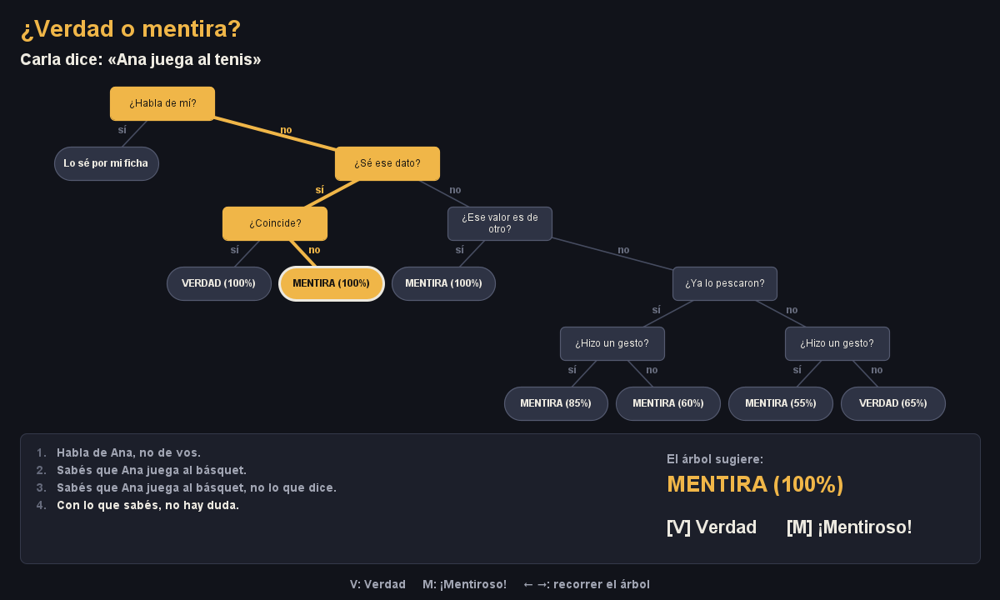
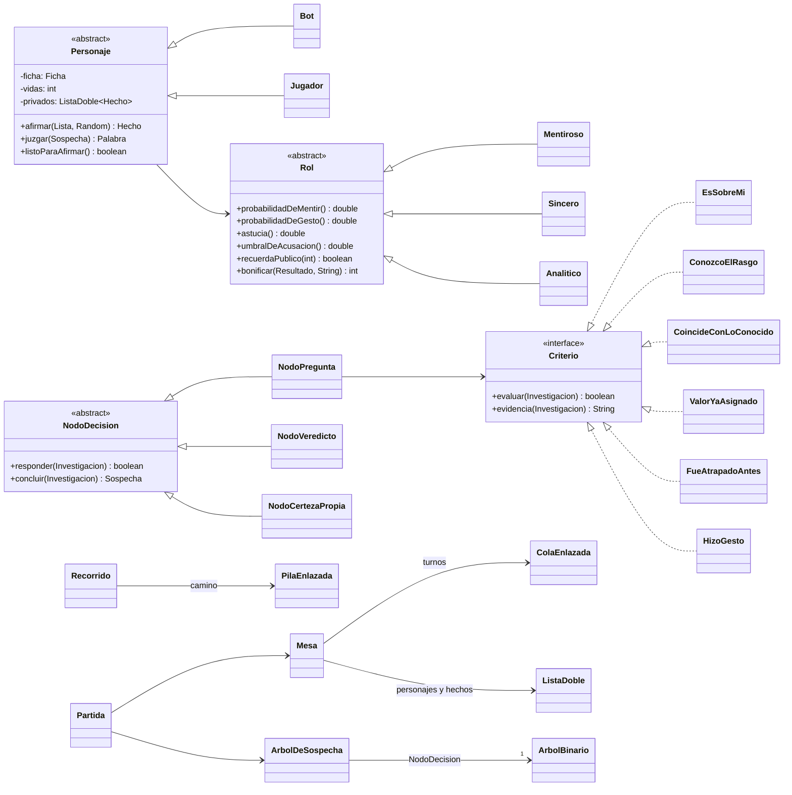
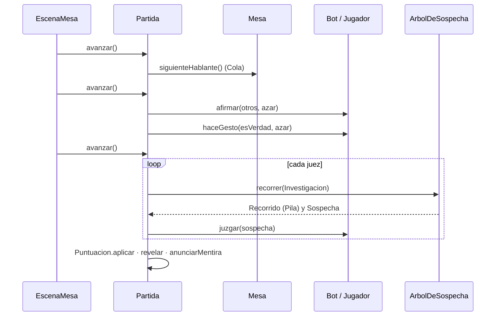

# Mentiroso

Juego de deducción para una mesa de cinco, hecho en Java sobre el kit de la Game Jam de Programación II (TUP, UTN FRRE). Por turno, alguien afirma algo sobre otro jugador, y los demás deciden si le creen recorriendo un **árbol de decisión binario**. Ese árbol queda a la vista: se abre en grande cuando juzgás y, en la mesa, un minimapa muestra el camino que siguió cada personaje.



## Cómo se juega

- **La mesa.** Juegan cinco: vos y cuatro bots. Hay 2 **Mentirosos**, 2 **Sinceros** y 1 **Analítico**. A vos te toca uno de esos roles al azar, y los roles de los demás son secretos hasta el final.
- **La ficha.** Cada uno tiene una ficha secreta con cuatro rasgos (mascota, deporte, comida y ciudad), cada uno con cinco valores posibles. Cada valor le toca a **una sola persona**: si el gato es tuyo, nadie más lo tiene. Al empezar, cada uno conoce además dos datos privados de otros jugadores.
- **El turno.** El que habla afirma algo de otro, por ejemplo «Carla tiene un gato». Puede ser verdad o mentira, y a veces se le escapa un gesto nervioso.
- **El juicio.** Juzgan los tres que no son ni el que habla ni aquel de quien se habla. Los bots dicen «Te creo» o «¡Mentiroso!». Vos elegís **Verdad** o **¡Mentiroso!** después de recorrer tu árbol.
- **La revelación.** Si alguien acusa, se revela el valor real y pasa a ser un dato de toda la mesa.

| Resultado | Puntos |
| --- | --- |
| Mintió y nadie lo acusó | El que habló +2 |
| Mintió y lo acusaron | El que habló pierde una vida; cada acusador +1 |
| Dijo la verdad y lo acusaron | Cada acusador pierde una vida; el que habló +1 |
| Dijo la verdad y nadie lo acusó | El que habló +1 |

Cada rol suma además su propio bonus:

| Rol | Bonus |
| --- | --- |
| Mentiroso | +2 por cada mentira que nadie acusa |
| Sincero | +1 por cada mentira que acusa bien |
| Analítico | +1 por cada juicio acertado en una afirmación que alguien acusó |

La partida termina después de 15 afirmaciones (tres vueltas a la mesa), cuando te quedás sin vidas o cuando quedan menos de tres en juego. Al final adivinás el rol de cada uno: cada acierto suma 2 puntos. Después se revelan los roles y el ranking.

### Controles

| Pantalla | Teclas |
| --- | --- |
| Mesa | `ESPACIO` pasa de turno o apura · `1`–`5`, `TAB` o un click en un asiento eligen qué árbol muestra el minimapa |
| Afirmar | `1`–`4` o `TAB` eligen a quién · `←` `→` el rasgo · `↑` `↓` el valor · `ENTER` afirma |
| Investigación | `→` avanza un nodo · `←` retrocede · en la hoja, `V` Verdad o `M` ¡Mentiroso! |
| Adivinar roles | `↑` `↓` eligen persona · `←` `→` eligen rol · `ENTER` confirma |
| Todas | `ESC` vuelve al menú |

## El árbol de sospecha

Todos usan el mismo árbol, pero cada uno lo recorre con **lo que sabe**: su ficha, sus datos privados, los datos públicos que recuerda y a quién vio mentir. Por eso dos jueces pueden llegar a hojas distintas frente a la misma afirmación. La rama izquierda es «sí» y la derecha, «no».



La hoja da una sospecha con su confianza, y cada rol decide desde qué probabilidad de mentira acusa: el Mentiroso desde 0,50, el Analítico desde 0,65 y el Sincero desde 0,80.



Se ve en dos lugares:

- **Investigación.** Cuando te toca juzgar, el árbol se abre nodo por nodo. Al lado de cada paso aparece la evidencia, por ejemplo «Sabés que Carla juega al básquet». Con las flechas se avanza y se retrocede.
- **Minimapa.** En la mesa muestra el camino del personaje elegido, la hoja a la que llegó y lo que dijo, **sin marcar si acertó**. Los caminos de los bots aparecen recién cuando juzgaron todos.

## Estructura del repositorio

```
src/
├── motor/          kit: ventana, bucle, escenas, entrada, temporizador
├── contratos/      kit: Actualizable y Dibujable
├── ui/             kit: Texto
├── verificador/    kit: verificador de Lista, Pila y Cola (PruebaMisEstructuras activado)
├── demo/           kit: demo del motor
├── estructuras/    interfaces del kit + ListaDoble, PilaEnlazada, ColaEnlazada, ArbolBinario, NodoArbol
├── juego/
│   ├── modelo/     Rasgo, Ficha, Hecho, Afirmacion, Sospecha, Palabra, Resultado
│   ├── entidades/  Rol (Mentiroso, Sincero, Analitico) y Personaje (Jugador, Bot)
│   ├── arbol/      Criterio y sus seis criterios, NodoDecision y sus tres nodos, ArbolDeSospecha, Recorrido, Investigacion
│   ├── reglas/     Mesa, Repartidor, Partida, Juicio, Puntuacion
│   └── pantallas/  Main, siete escenas, VistaMesa, VistaArbol, MinimapaArbol, Hud, Parrafo, Paleta
└── pruebas/        Comprobador y una prueba por paquete
docs/               enunciado de la jam y capturas
```

### Taxonomía

- **Un paquete por responsabilidad**, y las dependencias van en un solo sentido, sin ciclos: `pantallas → reglas → arbol → entidades → modelo → estructuras`. Por eso el juicio de cada personaje (su recorrido y su palabra) lo guarda `reglas.Juicio` y no `Personaje`: si lo guardara `Personaje`, `entidades` dependería de `arbol`.
- **Nombres en español**, con el sufijo técnico en inglés sólo donde lo impone Java.
- **`modelo`** tiene los datos inmutables que validan en el constructor. **`entidades`** tiene lo que decide. **`arbol`** tiene cómo se decide. **`reglas`** tiene el orden del juego. **`pantallas`** sólo dibuja y lee teclas.

## Diseño orientado a objetos



- **Clase abstracta con tres subclases que se comportan distinto:** `Rol`. Cada rol redefine cuánto miente, qué tan seguido se le escapa un gesto, con cuánta astucia elige sus mentiras, desde qué sospecha acusa, qué recuerda y qué bonus cobra. El Sincero olvida los datos públicos viejos y el Analítico sólo miente donde no lo pueden deducir.
- **Interfaz propia con varias implementaciones:** `Criterio` tiene seis. El recorrido del árbol no pregunta por tipos: cada nodo se responde solo, y las tres subclases de `NodoDecision` también se resuelven por polimorfismo.
- **Encapsulamiento:** atributos `private`, constructores y setters que validan. Por ejemplo, las vidas van de 0 a 3, una afirmación no puede ser sobre uno mismo, una confianza no puede ser menor a 0,5 y un nodo no puede colgarse de un árbol ajeno.
- **Sobrecarga:** `Afirmacion` se construye por partes o a partir de un `Hecho`. `Mesa.buscar` recibe un nombre o un número de asiento.

## Estructuras de datos

| TAD | Implementación | Para qué se usa | Por qué esa |
| --- | --- | --- | --- |
| Lista | `ListaDoble<T>` | La mesa, los datos públicos y privados, el historial, el camino del minimapa y el ranking | Se recorre entera y se accede por posición. Es doble para llegar a los dos extremos en O(1), e `Iterable` para usar for-each |
| Cola | `ColaEnlazada<T>` | El orden de los turnos: el que habla se desencola y vuelve al final; quien se quedó sin vidas no vuelve | FIFO: la ronda gira siempre igual |
| Pila | `PilaEnlazada<T>` | El camino de la investigación. Retroceder desapila; para leer el camino de la raíz a la hoja se pasa a una pila auxiliar y se vuelve a apilar | LIFO: retroceder deshace siempre el último paso |
| Árbol | `ArbolBinario<T>` y `NodoArbol<T>` | El árbol de sospecha. Inorden ubica cada nodo en pantalla; preorden y postorden se prueban en `PruebaArbol` | Cada pregunta tiene dos salidas y las hojas son conclusiones |

Fuera de los TAD no hay colecciones de `java.util` ni arreglos: los valores de cada rasgo viven en una `ListaDoble` dentro del enum, en vez de usar `values()`, y el texto se corta en palabras sin `split`.

## Flujo de un turno



Si le toca al humano, la `Partida` se detiene: `EscenaMesa` pasa a `EscenaAfirmar` o a `EscenaInvestigacion`, la decisión se carga en el `Jugador` y la mesa sigue.

## Compilar, jugar y probar

Requiere un JDK 11 o superior.

| Sistema | Compilar | Jugar | Probar todo |
| --- | --- | --- | --- |
| Linux / macOS | `./compilar.sh` | `./ejecutar.sh` | `./probar.sh` |
| Windows | `compilar.bat` | `ejecutar.bat` | `probar.bat` |

`ejecutar` sin argumentos abre el juego. Con un argumento corre otra clase, por ejemplo `ejecutar.bat demo.Main`. En un IDE, `src` es la carpeta de fuentes y la codificación tiene que ser **UTF-8**.

`probar` compila de cero y corre:

- `verificador.PruebaMisEstructuras`: el verificador del kit sobre la Lista, la Pila y la Cola;
- `pruebas.PruebaArbol`: la forma, los recorridos y las validaciones del árbol binario;
- `pruebas.PruebaFichas`: el reparto de fichas sin valores repetidos y las validaciones del modelo;
- `pruebas.PruebaPersonajes`: el reparto 2-2-1, que un Sincero nunca mienta, la memoria de cada rol y los bonus;
- `pruebas.PruebaCriterios`: un escenario por cada hoja del árbol, y el retroceso con la Pila;
- `pruebas.PruebaReglas`: la cola de turnos, la tabla de puntaje, 200 partidas simuladas de punta a punta y que el minimapa no muestre caminos antes de tiempo.

`probar.sh` además rechaza colecciones de `java.util` y arreglos dentro de `src/juego`. GitHub Actions corre `probar.sh` con Java 11 en cada pull request y en cada push a `develop` o `main`.

## Ramas

`main` tiene lo entregado y `develop`, lo integrado. Cada cambio entra desde una rama `feature/*` por pull request, con la verificación en verde.
